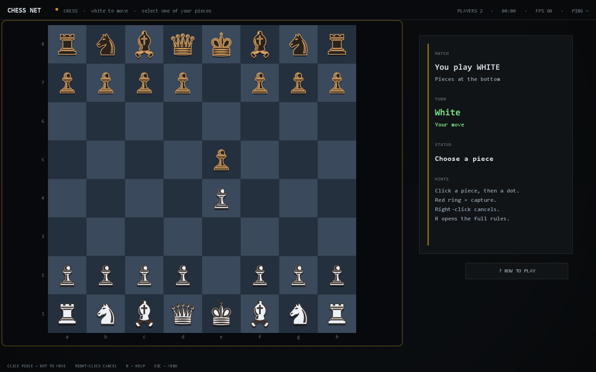
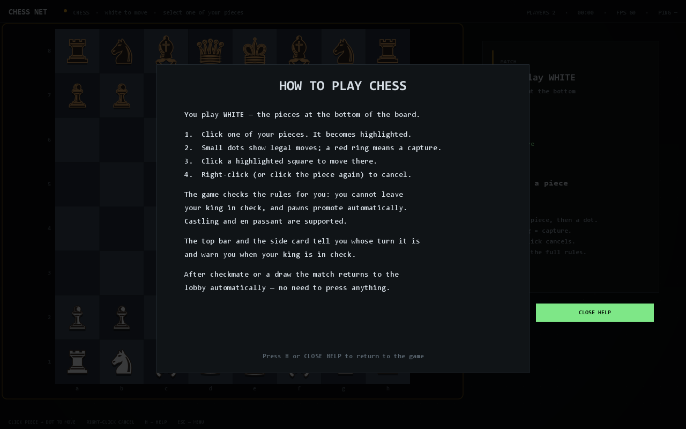
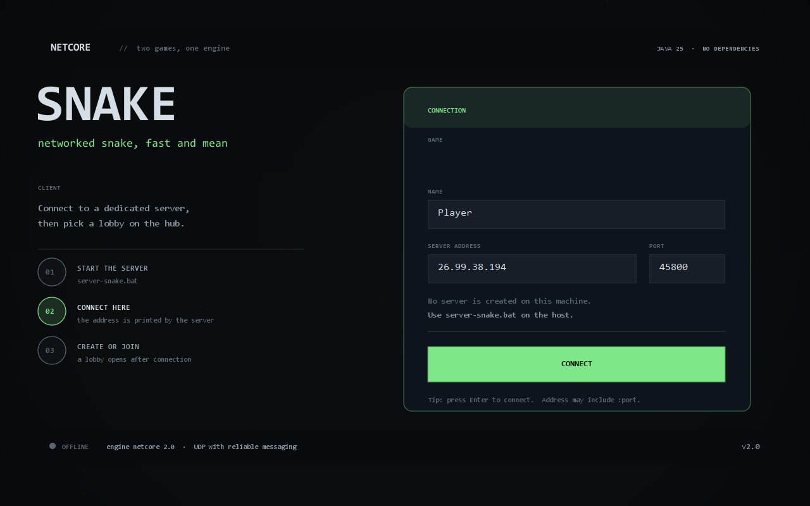
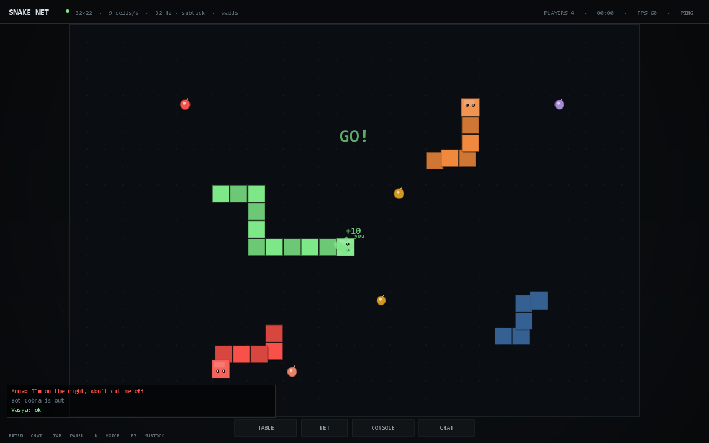
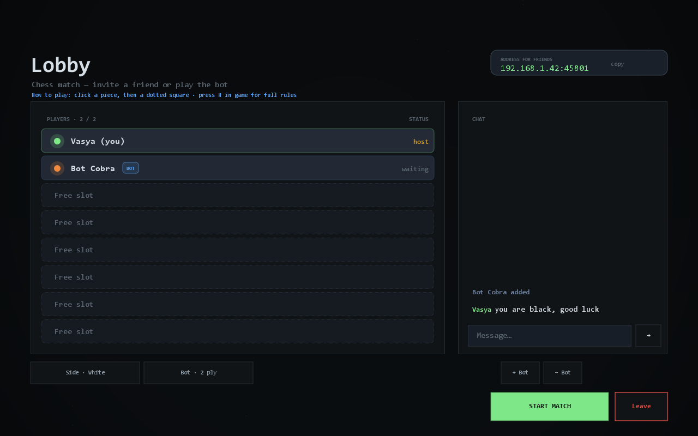

# Snake NET

Two complete multiplayer games on one small, dependency-free Java engine.

**Snake** is real-time: a tick loop, client-side prediction, rollback and reconciliation, subtick
input, bots, voice chat and many independent lobbies per server.

**Chess** is turn-based: an authoritative legal-move server, a search bot, replicated board state,
and a two-player lobby with side selection.

Both are examples of the same engine. Neither game needs engine source changes to play, extend or
replace — the engine ships as `NetCore.jar`. The games themselves are fully separate: different
JARs, protocols, source trees, lobbies and server programs.



## Requirements

- **Java 25 or newer** — [Temurin 25](https://adoptium.net/temurin/releases/?version=25)
- Windows for the included `.bat` launchers; the Java sources are portable
- No Gradle, Maven or external libraries

## Build

```bat
build.bat
```

This compiles the engine and both games independently and writes:

```
NetCore.jar    the engine
SnakeNET.jar   snake client + snake dedicated server
ChessNET.jar   chess client + chess dedicated server
```

## Play

Each game has its own folder, own launcher, own JAR and own dedicated server.

| What | Launcher | Dedicated server |
|---|---|---|
| Snake | `examples\snake\play.bat` | `examples\snake\server.bat` |
| Chess | `examples\chess\play.bat` | `examples\chess\server.bat` |

The same entry points are available in the repository root:

```bat
run-snake.bat        snake connection screen
server-snake.bat     snake dedicated server, port 45800
run-chess.bat        chess connection screen
server-chess.bat     chess dedicated server, port 45801
run.bat              launches snake unless --game=chess is passed
```

### Connect and play

Clients never start a server. A server is a separate program; clients only connect to one.

1. On the host machine, start `server-snake.bat` or `server-chess.bat`. The console prints the
   address and port.
2. Every player starts `run-snake.bat` or `run-chess.bat`.
3. On the connection screen, enter the server address and port, then press **CONNECT**.
   Addresses may be entered as `192.168.0.5:45800`.
4. The hub opens. **CREATE LOBBY** opens a new match, or pick a lobby that is already listed.
5. The lobby host presses **START GAME** (snake) or **START MATCH** (chess). With a single player,
   the empty seats are filled by bots.

### Dedicated server

Run `server-snake.bat` or `server-chess.bat` on a machine that should only host. The console prints
the address. Players connect to it with the connection screen, then create or join a lobby. A
dedicated server has no local player and never starts a match by itself.

```bat
java -cp "SnakeNET.jar;NetCore.jar" snakenet.snake.SnakeServer --port=45800
java -cp "ChessNET.jar;NetCore.jar" snakenet.chess.ChessServer --port=45801
java -cp "SnakeNET.jar;NetCore.jar" snakenet.snake.server.StandaloneServer --port=45800
java -cp "ChessNET.jar;NetCore.jar" snakenet.chess.server.StandaloneServer --port=45801
```

### Chess is a separate game

Chess is not a toggle inside snake. It has its own source tree, JAR, launcher, server, protocol,
lobby and rendering code. Choose **White**, **Black** or **Random**, pick the bot difficulty, and
create a match. A second player takes the opposite colour. To help new players, the lobby explains
the basic click flow, the match screen shows a contextual status line, and **H** opens a full
how-to-play overlay.

When a chess game ends, the result is shown for a few seconds and the room returns to the lobby
automatically. The losing player cannot keep moving pieces.

> If Windows Firewall asks, allow Java on private networks. The game uses UDP.



## Controls

### Snake

| Key | Action |
|---|---|
| Arrows / WASD | turn |
| K | push-to-talk |
| Tab | players, network and console panel |
| Enter | send chat |
| Esc | pause menu |

The lobby host can set the field, speed, tick rate, subtick input, walls and self-collision. With
**Self · safe** a snake may pass through its own body; with **Self · lethal** it dies. Safe is the
default so new players can learn the controls.

### Chess

| Input | Action |
|---|---|
| Left click a piece | select it |
| Left click a highlighted square | move |
| Right click | clear selection |
| H | open/close the rules overlay |
| Esc | pause menu |

The top bar shows whose turn it is and whether it is your move. The side card explains the board
orientation and lists a short reminder of the click flow.

## Screenshots

| Snake connect | Snake match | Chess lobby | Chess |
|---|---|---|---|
|  |  |  |  |

More screens are in [`docs/screens`](docs/screens).

## What is in the engine

`NetCore.jar` is a plain Java library with no knowledge of snake or chess:

- fixed-rate and subtick tick scheduling;
- UDP transport with reliability, ordering, fragmentation, retransmission, compression and a TCP
  fallback;
- clock synchronisation, RTT, jitter, loss and quality scoring;
- declared messages and direction-checked RPCs;
- replicated objects, observers and SyncVars;
- client-side prediction, rollback, replay and smooth corrections;
- voice capture, jitter buffering, mixing, abuse protection and an optional WebRTC switch;
- LAN discovery and a matchmaking queue;
- reconnect with session resume.

The games own their protocol, rules, lobbies, rendering and UI. That split is what lets each game
ship as a self-contained program on top of the same engine.

```
engine/src/main/java/netcore/          engine sources
examples/snake/src/main/java/          snake: client, core, net, server, tools, ui
examples/chess/src/main/java/          chess: client, core, net, server, tools, ui
docs/GUIDE.md                          build your own game with NetCore.jar
docs/API.md                            complete protocol and class reference
```

## Build your own game

The guide is written for people who want to use the JAR, not the engine source:

- [docs/GUIDE.md](docs/GUIDE.md) — a complete, practical walkthrough: protocol, server, client,
  lobbies, tick vs turn, snapshots vs SyncVars, prediction, voice, reconnect, packaging.
- [docs/API.md](docs/API.md) — every class, message field and configuration option.
- [engine/README.md](engine/README.md) — the engine itself, module by module.

A new game needs exactly one dependency:

```bat
javac -cp "NetCore.jar" -d out src\mygame\*.java
java  -cp "out;NetCore.jar" mygame.Main
```

Start with the checklist at the end of the guide. It covers the decisions that cause most
multiplayer bugs: who is authoritative, what is reliable, what is replicated, and how a late
joiner receives the full state.

## Tests and tools

```bat
java -Djava.awt.headless=true -cp "SnakeNET.jar;NetCore.jar" snakenet.snake.SelfTest
java -Djava.awt.headless=true -cp "ChessNET.jar;NetCore.jar" snakenet.chess.SelfTest
java -cp "SnakeNET.jar;NetCore.jar" snakenet.snake.tools.SubtickProbe 64 8
java -cp "SnakeNET.jar;NetCore.jar" snakenet.snake.tools.NetBench
java -cp "SnakeNET.jar;NetCore.jar" snakenet.snake.tools.ChaosProxy 45990 127.0.0.1 45800 80 20 2
```

The snake self-test runs 216 checks across ticks, transport, compression, prediction, voice,
declared messages, SyncVars, multi-lobby isolation and full networked rounds with bots and
reconnects. The chess self-test runs 38 checks over the rules, configuration and a real
client/server chess round with a bot. `ChaosProxy` adds latency and loss so prediction and voice
can be tested under bad conditions.

## License

No license file is included in this repository. Add one before distributing the code or the JARs.
