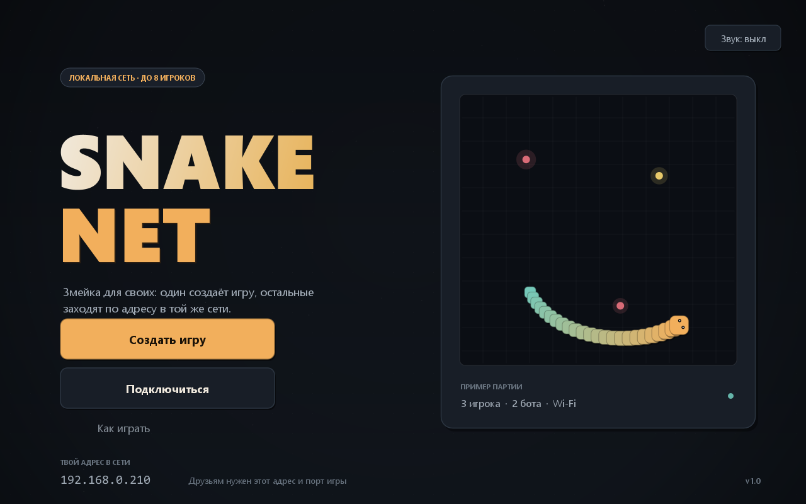
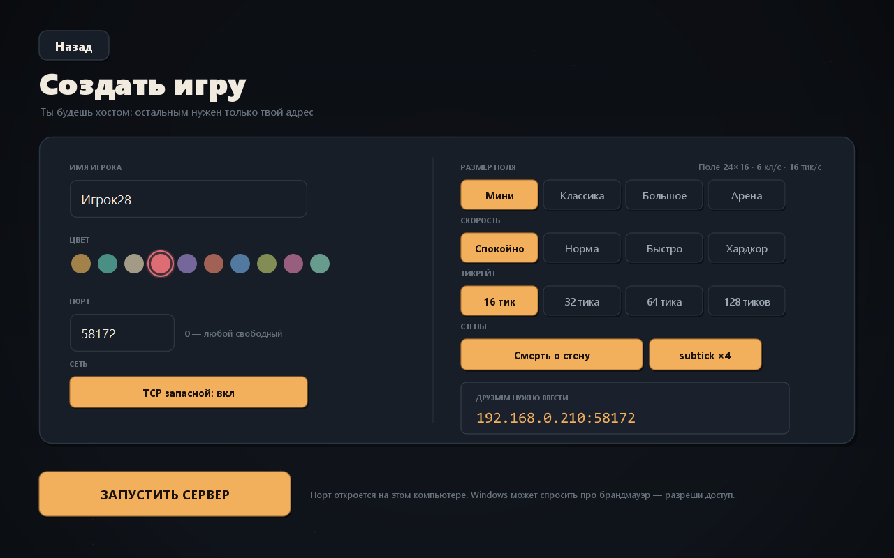
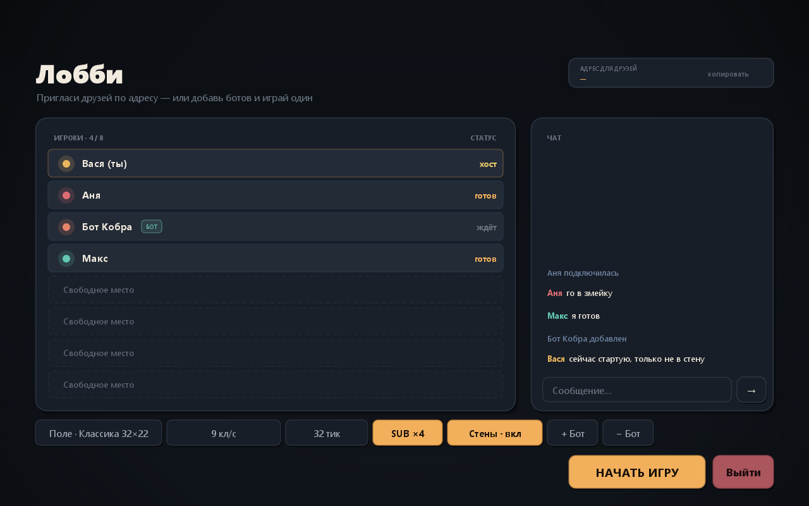
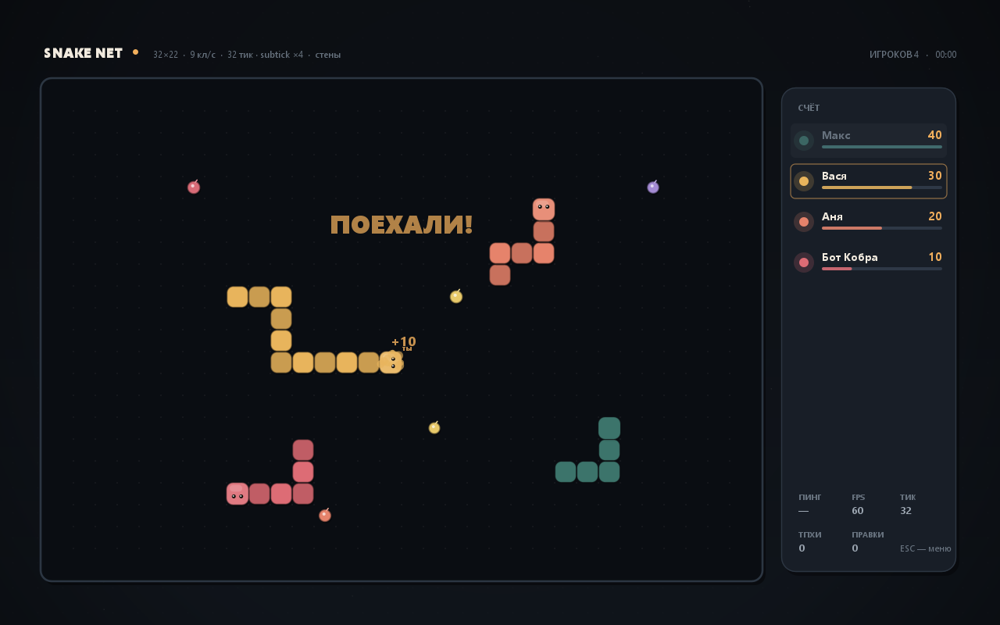

# SNAKE.NET

Змейка на несколько человек по домашней сети. Один запускает игру у себя, остальные заходят
по адресу вроде `192.168.0.5:45800`. Ни аккаунтов, ни облака, ни матчмейкинга — просто игра
для своей кухни.

Начал я её ради сетевой части. Хотелось написать свой маленький движок — тики, предсказание
ввода, коррекции — а змейка для этого удобный полигон: правил мало, зато все сетевые косяки
сразу видны. Поэтому в репозитории два независимых куска:

* `engine/` — движок `NetCore` (транспорт, тики, предсказание). Про змейку не знает ничего.
* `game/` — сама змейка. Знает про движок, движок про неё — нет.



## Что нужно

Windows и Java 17+. Искать её руками не надо: `run.bat` проверит `JAVA_HOME`, `PATH` и
стандартные папки. Если не найдёт — скажет, откуда скачать.

## Как запустить

1. Запустить `run.bat`.
2. «Создать игру» — имя, порт, поле, скорость, тикрейт. Дальше «Запустить сервер».
3. В лобби сверху будет адрес. Его и кидать друзьям — рядом есть кнопка «копировать».
4. Друзья запускают `run.bat`, жмут «Подключиться» и либо выбирают игру из списка
   (серверы в сети находятся сами), либо вбивают адрес вручную.
5. Когда все зашли — «Начать игру».

Играть не с кем — в лобби есть «+ Бот». Или сразу `run.bat --demo`: сервер, три бота и старт.

| Создание игры | Лобби |
|---|---|
|  |  |

## Управление и правила

Стрелки или WASD, `Esc` — меню.

Точка даёт 10 очков и две клетки длины. Стены и чужие хвосты убивают, лоб в лоб — умирают оба.
Убитая змейка рассыпает еду, её можно подобрать. Раунд кончается, когда остаётся один живой,
победитель считается по очкам.



## Настройки

Всё это меняет хост в лобби, остальные видят сразу.

* **Поле** — от 24×16 до 44×18.
* **Скорость** — 6, 9, 12 или 15 клеток в секунду.
* **Тикрейт** — 16, 32, 64 или 128 тиков в секунду. На скорость не влияет, только на отзывчивость.
* **subtick** — ввод с точностью до доли тика (4 подшага).
* **Стены** — смерть о стену или телепорт на другую сторону.
* **TCP запасной** — если UDP не проходит, клиент откатится на TCP. Выключается на экране
  создания игры.

## Сеть

По умолчанию UDP. Надёжность сделана руками: ввод, чат и лобби идут с подтверждениями и
переотправкой, снимки поля — без них. Потерялся снимок — не страшно, следующий новее.

TCP остался как запасной канал и включается в настройках. Сервер слушает оба транспорта на
одном порту, клиент сам выбирает.

Автообнаружение — UDP-бродкаст на 45777. Хост раз в секунду кричит «я тут», клиент слушает.

### Предсказание и «тпха»

Свою змейку клиент двигает сам, не дожидаясь ответа сервера. Нажатие уходит на сервер
с номером и тиком, применяется локально, а когда приходит серверный снимок — клиент откатывается
к нему и переигрывает всё, что сервер ещё не подтвердил. Если расхождение большое (больше
2.2 клетки) — змейка переносится к серверной позиции, в HUD щёлкает счётчик «ТПХИ». Если
маленькое — просто переигрывается, это «ПРАВКИ».

## Если не подключается

Сначала проверьте, что оба компьютера в одной сети. Мобильный интернет, гостевой Wi-Fi
с изоляцией клиентов и VPN — не считаются.

Дальше брандмауэр. При первом запуске сервера Windows спросит про доступ — надо разрешить.
Если окно случайно закрыли, есть `allow-firewall.bat`: запустить от администратора, он откроет
45800/TCP и 45777/UDP.

Если автопоиск никого не видит — введите адрес руками, так работает всегда. Адрес должен быть
вида `192.168.*` или `10.*`, а не `127.0.0.1`.

## Сборка

Нужен JDK 17+, не JRE. `build.bat` сам найдёт `javac` и соберёт два jar-а:

```
NetCore.jar   — движок
SnakeNET.jar  — игра
```

Запуск: `java -cp "SnakeNET.jar;NetCore.jar" snakenet.Main` или просто `run.bat`.

Вручную примерно так:

```
dir /s /b engine\src\main\java\*.java > engine-src.txt
javac -encoding UTF-8 -d out\engine @engine-src.txt

dir /s /b game\src\main\java\*.java > game-src.txt
javac -encoding UTF-8 -cp out\engine -d out\game @game-src.txt

jar --create --file NetCore.jar -C out\engine .
jar --create --file SnakeNET.jar --manifest manifest.txt -C out\game .
```

## Тесты

```
java -Djava.awt.headless=true -cp "SnakeNET.jar;NetCore.jar" snakenet.SelfTest
```

61 проверка: тики и тикрейт, математика предсказания, транспорт на UDP и TCP, синхронизация
часов, автообнаружение, полный сетевой раунд на трёх клиентах, боты, отключения. Есть и
отдельная проверка на плавность — чтобы змейка не прыгала на клетку за кадр.

Скриншоты для документации рендерятся без окна:

```
java -cp "SnakeNET.jar;NetCore.jar" snakenet.tools.UiShots docs\screens
```

## Что не сделано

Честно: кое-что я оставил на потом.

* Нет сжатия снимков — гоняется полное состояние поля. На восьмерых в локальной сети хватает,
  но по-хорошему надо дельту.
* Джиттер-буфер для чужих змеек фиксированный, адаптивной задержки нет.
* Раунд один: сыграли, посмотрели итоги, хост нажал «ещё раз». Турнирной таблицы между
  партиями нет.
* UDP не умеет в path MTU discovery — размер пакета зашит.

## Структура

```
engine/src/main/java/netcore/
  time/       тики 1..128, TickRunner, TickClock
  net/        UDP и TCP транспорт, сервер/клиент, кадры, автообнаружение
  sync/       оценка RTT и часов сервера
  predict/    предсказание, переигровка, порог тпхи

game/src/main/java/snakenet/
  game/       правила: поле, змейка, боты
  client/     клиент, снимки, предсказание своей змейки, геометрия рендера
  server/     сервер, комната (лобби, раунд, итоги)
  ui/         интерфейс
  tools/      офскрин-рендер скриншотов

run.bat                запуск
build.bat              сборка обоих jar
allow-firewall.bat     правила брандмауэра
docs/screens/          скриншоты
```

API движка описан в [engine/README.md](engine/README.md).

## Лицензия

Делайте что хотите.
