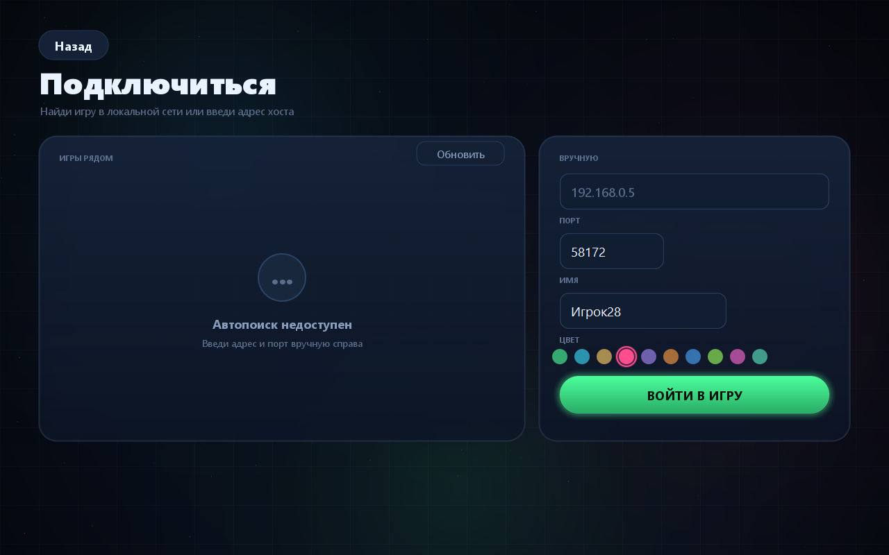
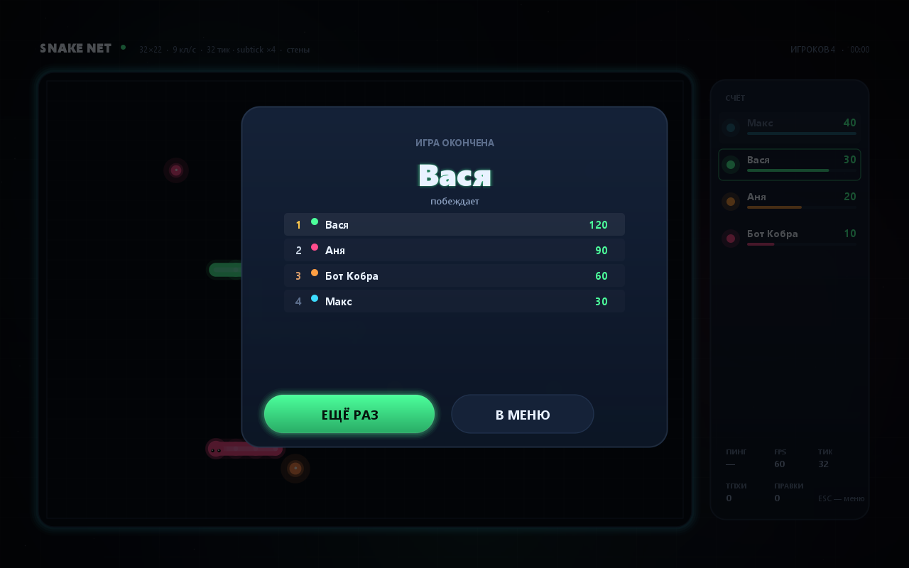

# SNAKE NET — сетевая змейка на своём сетевом движке

Мультиплеерная змейка для локальной сети: один игрок создаёт игру у себя на компьютере,
остальные подключаются по адресу вида `192.168.0.5:45800` — или находят игру автоматически.
Без интернета, без аккаунтов, без внешних серверов.

Проект разделён на два модуля:

| Модуль | Что это | Зависимости |
|---|---|---|
| **`NetCore.jar`** (`engine/`) | сетевой движок: тикрейт до 128, subtick, предсказание, синхронизация часов, транспорт, автообнаружение | только JDK |
| **`SnakeNET.jar`** (`game/`) | змейка — пример на этом движке: правила, боты, интерфейс | NetCore.jar |

Движок ничего не знает про змейку. Описание API — в [engine/README.md](engine/README.md).


| Создание игры | Подключение |
|---|---|
|  |  |

| Лобби | Партия | Итоги |
|---|---|---|
|  |  |  |

---

## Быстрый старт (Windows)

1. Запусти **`run.bat`**.
2. **«Создать игру»** → имя, порт, поле, скорость, тикрейт → **«Запустить сервер»**.
3. В лобби сверху адрес, например `192.168.0.5:45800`, рядом «копировать».
4. Друзья в той же сети: `run.bat` → **«Подключиться»** → игра из списка «Игры рядом»
   или адрес вручную.
5. Хост жмёт **«Начать игру»**. После раунда — **«Ещё раз»**.

Без друзей: в лобби «+ Бот», или демо `run.bat --demo` (сервер + 3 бота и сразу старт).

### Нужна Java

**Java 17 или новее.** `run.bat` сам ищет её (JAVA_HOME, PATH, `Program Files\Java`,
Adoptium, Microsoft JDK и рантаймы Minecraft/Launcher). Не нашёл — поставь
[Temurin 17](https://adoptium.net/temurin/releases/?version=17).

---

## Как играть

| Действие | Клавиши |
|---|---|
| Поворот | `←` `↑` `→` `↓` или `W` `A` `S` `D` |
| Меню / выйти | `Esc` |

- Точка — **+10 очков** и +2 к длине.
- Стены (если включены) и чужие змейки убивают. Лоб в лоб — погибают оба.
- Убитая змейка рассыпает еду.
- Раунд кончается, когда остаётся один живой.

## Настройки (у хоста, в лобби)

- **Поле**: Мини 24×16, Классика 32×22, Большое 40×26, Арена 44×18.
- **Скорость**: 6 / 9 / 12 / 15 клеток в секунду — не зависит от тикрейта.
- **Тикрейт**: 16 / 32 / 64 / 128 тиков в секунду (максимум движка — 128).
- **subtick**: включить подшаги (×4) — ввод применяется с точностью до доли тика.
- **Стены**: смерть о стену или телепорт на другую сторону.
- **TCP запасной**: если UDP не проходит (редкий Wi-Fi), клиент сам откатится на TCP.
- **Боты**: до 8 участников вместе с людьми.

Тикрейт не делает змейку быстрее: он делает управление отзывчивее.
На 128 тиках ввод обрабатывается каждые 7.8 мс.

---

## Как это работает по сети

- **UDP** — основной транспорт: ввод и лобби с подтверждениями, снимки поля без досылки.
- **TCP** — запасной канал, включается/выключается в настройках хоста.
- Порт игры по умолчанию **45800** (`0` — любой свободный).
- **UDP 45777** — автообнаружение игр (маяк раз в секунду).
- Протокол — текстовые кадры `ТИП|поле=значение|...` + `END`; строки в base64url.
- Сервер тикает с выбранной частотой (16..128). Движение змейки копится
  в целочисленном накопителе, поэтому частота тика и скорость игры независимы.
- Снимки уходят ~30 раз в секунду, но рисуются не «по снимкам»: позиция берётся из накопителя движения и интерполируется между двумя состояниями — своя змейка из предсказания, чужие с задержкой в пару снимков. Поэтому все едут непрерывно, а не прыгают по клеткам.

### Предсказание и «тпха»

Клиент не ждёт ответа сервера, чтобы повернуть:

1. Нажатие сразу применяется локально (`Predictor.push`) и уходит на сервер
   с номером `n`, тиком `t` и долей тика `s`.
2. Сервер применяет ввод на указанном тике и подтверждает его полем `ls` в снимке.
3. Клиент откатывается к серверному состоянию, переигрывает неподтверждённые вводы
   и сравнивает предсказание с сервером на том же тике.
4. Ошибка больше порога (2.2 клетки) — **тпха**: змейка мгновенно переносится
   к серверной позиции, в HUD растёт счётчик «ТПХИ». Меньше — плавная правка,
   счётчик «ПРАВКИ».

Синхронизация часов — по пингам (лучшая выборка по RTT), оценка текущего тика
сервера — по последнему снимку. Всё это живёт в движке, змейка только описывает
свою модель движения.

### Если друзья не подключаются

1. **Одна сеть.** Один роутер/Wi-Fi; мобильный интернет, гостевой Wi-Fi с изоляцией
   клиентов и VPN мешают.
2. **Брандмауэр Windows.** При первом запуске сервера нажми «Разрешить».
   Пропустил — запусти **`allow-firewall.bat`** от администратора
   (45800/TCP и 45777/UDP).
3. **Адрес.** Нужен `192.168.*`/`10.*`, а не `127.0.0.1`.
4. **Порт занят** — выбери другой или оставь `0`.
5. **Автопоиск не видит** — введи адрес вручную, он работает всегда.

---

## Сборка из исходников

Нужен **JDK 17+**. `build.bat` сам его находит и собирает оба модуля:

```bat
build.bat
```

Результат: `NetCore.jar` (движок) и `SnakeNET.jar` (игра).
Запуск: `java -cp "SnakeNET.jar;NetCore.jar" snakenet.Main`
или просто `run.bat`.

Вручную:

```bat
dir /s /b engine\src\main\java\*.java > engine-src.txt
javac -encoding UTF-8 -d out\engine @engine-src.txt

dir /s /b game\src\main\java\*.java > game-src.txt
javac -encoding UTF-8 -cp out\engine -d out\game @game-src.txt

jar --create --file NetCore.jar -C out\engine .
jar --create --file SnakeNET.jar --manifest manifest.txt -C out\game .
```

Запуск без `.bat`:

```bat
java -cp "SnakeNET.jar;NetCore.jar" snakenet.Main
java -cp "SnakeNET.jar;NetCore.jar" snakenet.Main --demo
java -cp "SnakeNET.jar;NetCore.jar" snakenet.Main --screen=join
```

### Автотест

```bat
java -Djava.awt.headless=true -cp "SnakeNET.jar;NetCore.jar" snakenet.SelfTest
```

**59 проверок**: тикрейт (128, обрезка, подшаги), математика тиков, предсказание
и тпха, транспорт UDP + TCP, синхронизация часов, обнаружение по UDP, полный сетевой раунд
на трёх клиентах, боты, результаты, позднее подключение, отключение.

Скриншоты без запуска окна:

```bat
java -cp "SnakeNET.jar;NetCore.jar" snakenet.tools.UiShots docs\screens
```

---

## Структура проекта

```
engine/                     NetCore — сетевой движок (без игры)
  src/main/java/netcore/
    time/                   TickConfig 1..128, TickMode{FIXED,SUBTICK}, TickRunner, TickClock
    net/                    NetServer/NetClient, Connection, UDP и TCP транспорт, кадры, LAN-обнаружение
    sync/ClockSync          RTT и смещение часов сервера
    predict/Predictor       предсказание, переигровка, порог тпхи
  README.md                 API движка с примерами

game/                       змейка — пример использования движка
  src/main/java/snakenet/
    Main.java               точка входа, обработчик падений
    Prefs.java              ник, цвет, порт, звук
    SelfTest.java           автотесты (движок + игра)
    game/                   правила: поле, змейка, боты, настройки
    client/                 GameClient, Snapshot, ServerClock, SnakePredictState
    server/                 GameServer, Room (лобби, раунд, итоги)
    ui/                     тема, рисование, экраны, окно
    tools/UiShots.java      офскрин-рендер экранов

run.bat                     запуск (ищет Java 17+)
build.bat                   сборка обоих jar (ищет JDK 17+)
allow-firewall.bat          правила брандмауэра
manifest.txt                манифест SnakeNET.jar
docs/screens/               скриншоты
```

## Что можно докрутить

- Jitter-буфер и адаптивная задержка интерполяции чужих змеек.
- Сжатие снимков (дельта вместо полного состояния).
- Больше игр на движке: движок от них не зависит.
- Replay-запись вводов и тиков.

## Лицензия

Делай что хочешь. Код учебный, но играбельный.
