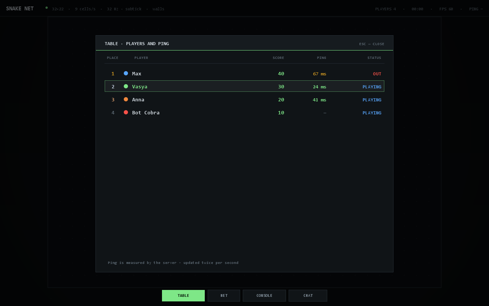
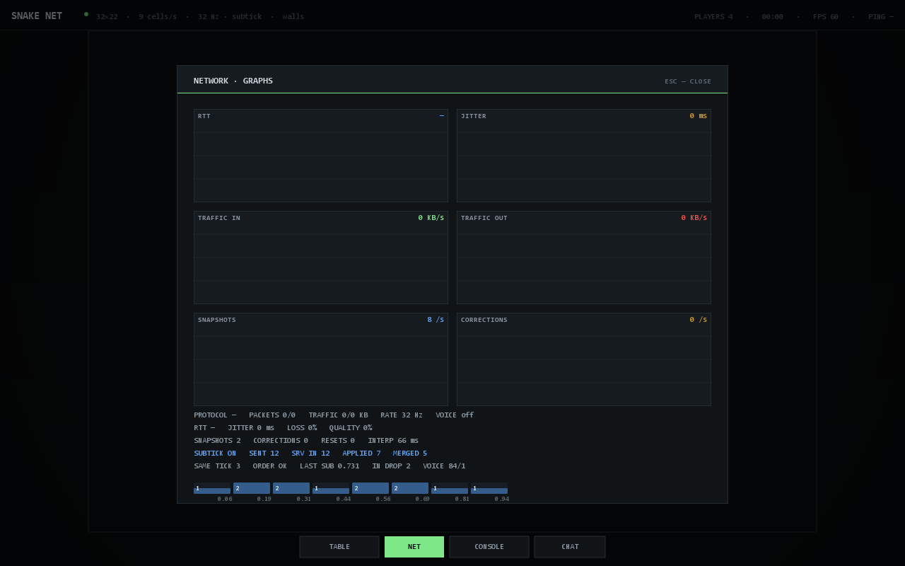
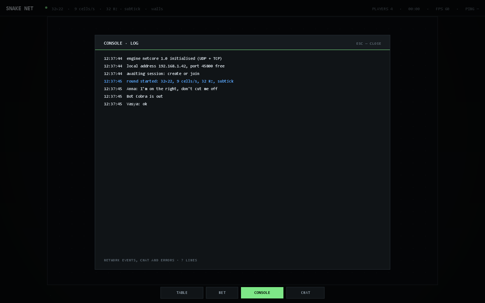
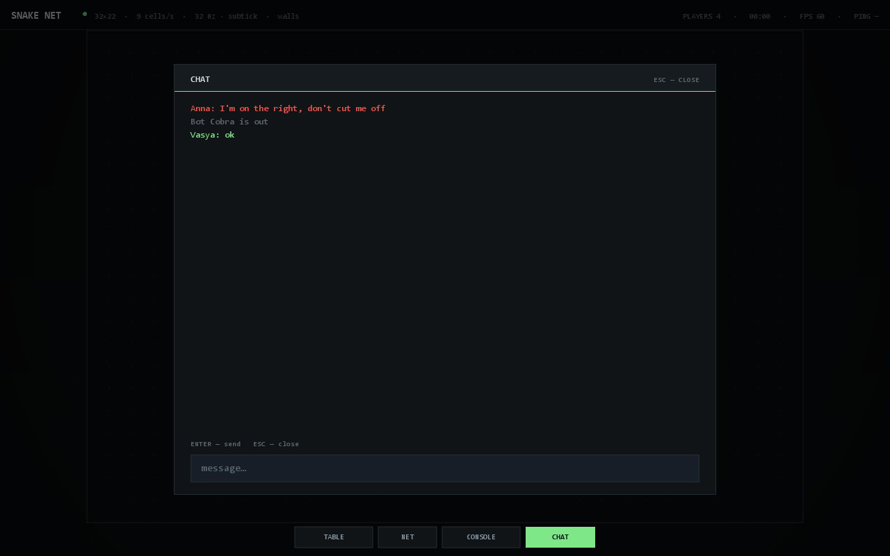
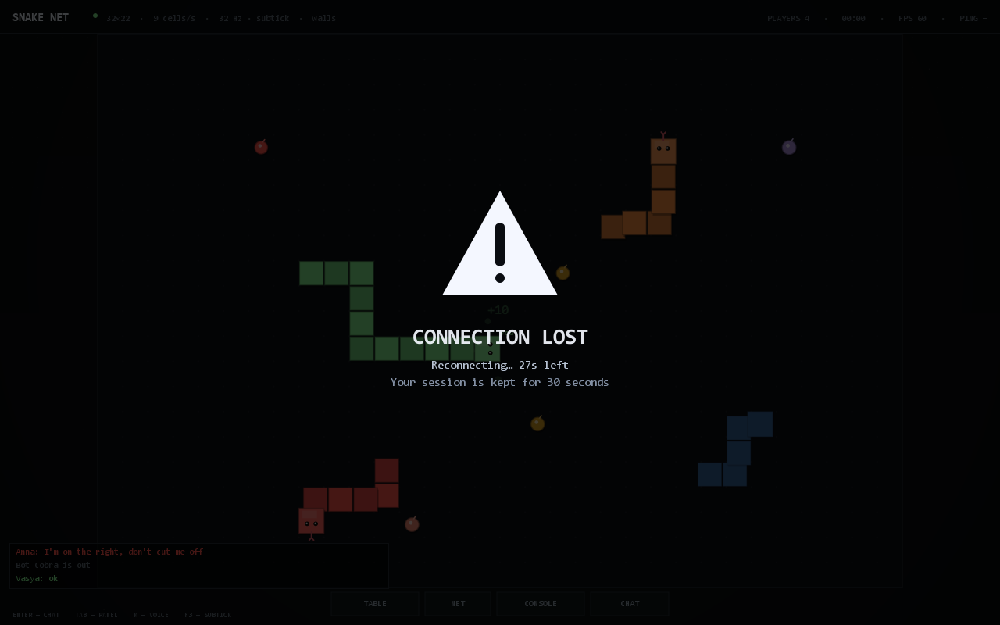

# SNAKE.NET

Multiplayer snake over a home network, plus a test bench for the networking engine underneath it.
The host runs the server, everyone else joins an address such as `192.168.0.5:45800`.

The project started with the engine — a custom tick loop, input prediction and reconciliation —
and snake is simply a playground where all of it is visible. That is why the UI behaves like a
control panel: telemetry, graphs, a live log. Desyncs are easier to catch with numbers than by feel.


## Requirements

Windows and Java 25+. `run.bat` looks for it in `JAVA_HOME`, `PATH` and the usual install folders.

## How to play

1. `run.bat` opens the control panel.
2. **Create game**: name, port, field size, speed, tick rate, transport (UDP or TCP). Then **Start server**.
3. The lobby shows the address at the top — send it to your friends. There is a copy button next to it.
4. Friends: `run.bat` → **Join** → the game appears in the LAN list, or type the address manually.
5. The host presses **START GAME**.

You can add bots in the lobby and play alone, or launch `run.bat --demo` for an instant match.

| Create game | Lobby |
|---|---|
|  |  |

## Controls

| | |
|---|---|
| Turn | arrow keys or WASD |
| In-game chat | `Enter` to open, `Esc` to close |
| Panel | `Tab` for table / network / console / chat, or the buttons at the bottom |
| Voice | `K` push-to-talk (lobby and match) |
| Subtick debug | `F3` toggles the input overlay and verbose subtick log |
| Menu | `Esc` when the panel is closed |

Food is worth 10 points and two cells of length. Walls and other snakes' tails kill; a head-on
collision kills both. A dead snake scatters food. The round ends when one player is left.


The board fills the screen, with tabs at the bottom centre: **TABLE** (score and ping for every
player), **NET** (RTT, jitter, traffic, snapshots, corrections), **CONSOLE** (events, chat, errors)
and **CHAT**. Player ping is measured by the server, so everyone sees it, not just you.

| Table and ping | Network graphs |
|---|---|
|  |  |

| Console | Chat |
|---|---|
|  |  |



The connection overlay uses a static white icon; only the text pulses.

## Connection loss and auto-reconnect

If the link drops, the client keeps retrying the same host and port for 30 seconds and tries to
reuse its previous UDP local port. The UI stays silent for the first 500 ms, then dims the screen
and shows a static white warning icon. Only the text pulses; the icon never blinks. If the link
comes back, play resumes without a restart; a **RECONNECTED** flash appears only when the
interruption lasted longer than 750 ms. After 30 seconds the client disconnects and the server
removes the player.

On the server side a player is kept for a 30 second grace window outside the lobby and marked
`reconnecting`. The session token sent with `HELLO` restores the same player and snake, so a
reconnect never creates a duplicate.

## Voice

`K` is push-to-talk: while held, the microphone records 16 kHz mono and 20 ms frames travel over
the same transport without acknowledgements. The server stamps the speaker id, validates the frame
with `VoiceGuard` and forwards it. On the client an adaptive jitter buffer reorders frames and the
engine mixes everyone into one output stream.

Voice lives in the engine (`netcore.voice`), not in the game. The engine-level switch is
`VoiceMode.UDP` (default) or `VoiceMode.WEBRTC`. WebRTC is an optional adapter: put
`webrtc-java` and its native library in `lib/`, provide a
`ServiceLoader` implementation of `WebRtcVoiceAdapter`, and set the mode to `WEBRTC`. If the
library or the adapter is missing, the engine reports the backend and falls back to the built-in
UDP path automatically; nothing in the game has to change. On a LAN the UDP path costs 32 KB/s per
speaker and stays within one frame of latency. Without a microphone the UI says so.

The voice budget is separate from game traffic, so a burst of voice packets cannot starve input or
snapshots. Duplicates, reordered frames, oversized packets and rate abuse are rejected and counted.
The **NET** tab shows the active backend (`UDP`, `WebRTC` or `UDP (WebRTC unavailable)`) and the
accepted/rejected frame counts.

## Chat

`Enter` in a match opens the **CHAT** tab with an input field, `Esc` closes it. Recent messages stay
visible over the board at the bottom left. `Tab` opens the panel on the last tab; switch tabs with
the bottom buttons or by pressing `Tab` again. In the lobby chat is always open on the right.
System lines (joined, eliminated, kicked) are grey and mirrored to the console.

## Kick

The host clicks a player twice in the lobby (the first click asks for confirmation). The server
sends `KICK` and closes the connection; the player sees the message and returns to the menu.

## Settings (host, in the lobby)

* **Field** — 24×16 … 44×18.
* **Speed** — 6 / 9 / 12 / 15 cells per second.
* **Tick rate** — 16 / 32 / 64 / 128. Does not change speed, only responsiveness.
* **Subtick** — every input carries a server timestamp and a fraction of a tick. The turn still
  lands on a cell boundary; the fraction selects which boundary. The newest press wins inside one
  tick.
* **Walls** — die against the wall or wrap around.
* **Transport** — UDP or TCP, chosen by the host on the create screen.

## Networking and reconciliation

UDP by default. Input, chat and lobby traffic is acknowledged and retransmitted; snapshots and
voice are not. The host picks the transport and the server listens only on it. The engine can also
run a UDP-first client that falls back to TCP after `connectTimeoutMs`, but only when a server
listens on both; the game exposes one explicit transport choice. The address shown in the lobby
does not change.

Your own snake is predicted locally: a key press goes to the server immediately with a sequence
number, tick, timestamp and fraction, and is applied on your side at once. Once per snapshot the
client compares its prediction with the server: a small difference is replayed, a large one snaps
the position to the authoritative state. Rendering follows a continuous accumulator instead of
blending discrete cells, so local and remote snakes move equally smoothly at 16, 32, 64 and 128 Hz.
A correction is eased over `predictionSmoothMs` (70 ms by default).

To avoid drifting, the server acknowledges every input as `A|n=17|t=105` — "applied input 17 on
tick 105". The client uses these to refine its tick estimate (`ServerClock.observeApply`), relabel
pending inputs before replay and converge the phase over roughly 0.7 s instead of jumping.

### Connection quality

Both sides track RTT, jitter, ping loss and a 0–100 quality score. The client exposes `rttMs()`,
`jitterMs()`, `lossPercent()` and `quality()`; the server exposes the same values per `Connection`.
The NET tab plots them live.

### Traffic compression

Payloads above 160 bytes are deflated when that actually saves space, up to a 1 MB cap. A payload
that does not compress is sent raw, so incompressible data never pays a penalty. Compression applies
to reliable and unreliable UDP traffic and to TCP frames.

### Flood protection

Each `Connection` has an incoming token bucket (packets and bytes per second). Clients that exceed
it are throttled and their excess packets are counted in `droppedPackets()`, so a misbehaving or
malicious peer cannot drown the server.

### Subtick debugging

Subtick input carries a server timestamp and a fraction of a tick from 0 to 1. The server turns the
timestamp back into a tick and fraction, validates that it is close enough to the current tick, and
applies the turn at the chosen cell boundary. When several presses target the same tick, the one
with the largest fraction wins, so the newest intent wins even inside one tick.

Open the **NET** tab to see the live state:

* `SUBTICK ON` / `OFF` — mode and the number of input slots.
* `SENT` — inputs sent by this client.
* `SRV IN` / `APPLIED` / `MERGED` — inputs received, inputs that became the winning direction, and
  extra inputs collapsed into the same slot.
* `SAME TICK` — inputs that shared a tick; press two keys quickly and this number should grow.
* `ORDER OK` — the highest fraction won every time; `ERR n` means ordering broke.
* `LAST SUB` — fraction of the last applied input.
* `IN DROP` — inputs the server rejected for bad timing, rate, sequence or queue length.
* `VOICE` — accepted/rejected voice frames.
* The histogram underneath the counters shows the distribution across input slots.

Press `F3` in a match to log every input (`IN #seq t=... sub=... dir=...`) and a once-per-second
server summary to the console, plus a compact overlay in the top-left corner. Press `F3` again to
hide it. The same path can be checked without the UI:

```
java -cp "SnakeNET.jar;NetCore.jar" snakenet.tools.SubtickProbe 64 8
```

It starts a headless server, sends four inputs with different fractions for one tick, and prints
the server counters, the bucket distribution and the direction that won.

## If it does not connect

Use one network. Mobile internet, guest Wi-Fi with client isolation and VPN do not work.
Firewall: allow the server on first launch, or run `allow-firewall.bat` as administrator
(45800/TCP and 45777/UDP). If auto-discovery cannot see the host, type the address manually —
it always works. The address should be `192.168.*` or `10.*`, not `127.0.0.1`.

## Build

JDK 25+, not a JRE.

```
build.bat
```

Output: `NetCore.jar` (engine) and `SnakeNET.jar` (game).
Run with `java -cp "SnakeNET.jar;NetCore.jar" snakenet.Main` or `run.bat`.

Both scripts add `lib/*.jar` to the classpath when that folder exists, so an optional WebRTC stack
can be dropped in without changing the build files.

## Tests

```
java -Djava.awt.headless=true -cp "SnakeNET.jar;NetCore.jar" snakenet.SelfTest
```

160 checks: tick rate and clock maths, prediction and replay, subtick ordering and reporting,
voice jitter and abuse guard, continuous render geometry at 16 and 32 Hz, game tuning factories,
UDP/TCP transport, clock synchronisation, compression, connection quality, flood protection,
auto-reconnect with a server restart, UDP reconnect without a second `onConnect`, LAN discovery, a
full three-client round, bots, kicks and reconnects. Separate motion checks confirm the head never
jumps a whole cell per frame.

Documentation screenshots are rendered off-screen with a placeholder address:

```
java -cp "SnakeNET.jar;NetCore.jar" snakenet.tools.UiShots docs\screens
```

## Developer tools

```
java -cp "SnakeNET.jar;NetCore.jar" snakenet.tools.NetBench
java -cp "SnakeNET.jar;NetCore.jar" snakenet.tools.ChaosProxy 45990 127.0.0.1 45800 80 20 2
java -cp "SnakeNET.jar;NetCore.jar" snakenet.tools.SubtickProbe 64 8
```

`NetBench` measures compression ratio, prints the quality score table and runs a loopback
throughput test. `ChaosProxy` is a UDP proxy that adds latency, jitter and packet loss, useful for
watching the reconnect overlay and reconciliation behaviour without unplugging anything.
`SubtickProbe` runs the subtick ordering check headlessly and exits non-zero on failure.

## Structure

```
engine/src/main/java/netcore/
  time/       ticks 1..128, TickRunner, TickClock
  net/        UDP/TCP transport, server, client, frames, compression, discovery
  sync/       RTT, jitter, loss, server clock
  predict/    prediction, replay, reset threshold
  voice/      voice engine, jitter buffer, abuse guard, WebRTC switch

game/src/main/java/snakenet/
  game/       rules and the central GameConfig tuning hub
  client/     client, snapshots, prediction, render geometry
  server/     room, lobby, round, reconnect grace, subtick counters
  audio/      sound effects
  ui/         control panel, screens, graphs, subtick overlay, reconnect overlay
  tools/      screenshot renderer, benchmark, chaos proxy, subtick probe
```

Engine API: [engine/README.md](engine/README.md). Wire protocol, game configuration and end-to-end
voice flow: [docs/API.md](docs/API.md).

## License

Do whatever you want.
